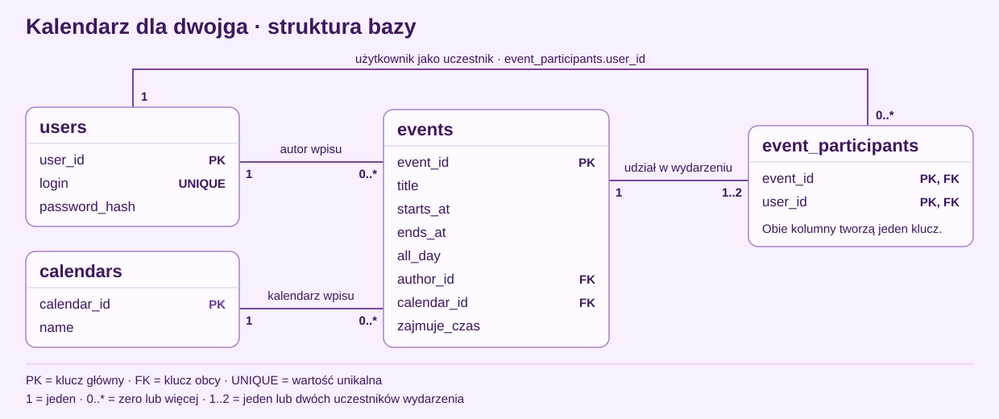

# Struktura bazy danych — robocze ustalenia

Wdrożoną wersję określa [schemat SQL](../../backend/schema.sql). Poniżej zachowano pierwotny model i diagram z nauki SQL. W implementacji doszły ustawienia kalendarza, wybory importu AGH i kolumny dla serii. Baza przechowuje czas w UTC, a PHP przelicza go na Europe/Warsaw. [Uruchomienie i działanie](URUCHOMIENIE.md)

Stan na 2026-11-20. Zapis dotychczasowej rozmowy i ćwiczeń z SQL.
To projekt struktury, nie gotowy skrypt tworzący bazę ani wykonana migracja.
Wymagania i kolejność implementacji opisuje [plan kalendarza](KALENDARZ_WDROZENIE.md).



## Pola obowiązkowe przy pierwszym zapisie

Proponujemy, żeby każda kolumna obecnego modelu miała wartość w zapisanym wierszu
(`NOT NULL`). Klucz główny już zapewnia ten warunek dla swoich kolumn.

| Tabela | Kolumny obowiązkowe | Skąd pochodzą wartości |
| --- | --- | --- |
| `users` | `user_id`, `login`, `password_hash` | ID identyfikuje konto, login jest unikalny, a PHP oblicza hash podczas ustawiania hasła. |
| `calendars` | `calendar_id`, `name` | ID i nazwę zapisujemy podczas tworzenia każdego z pięciu kalendarzy. |
| `events` | `event_id`, `title`, `starts_at`, `ends_at`, `author_id`, `calendar_id`, `all_day`, `zajmuje_czas` | Baza nadaje ID. PHP bierze autora z sesji. Tytuł, termin, kalendarz i ustawienia wpisu pochodzą z formularza. |
| `event_participants` | `event_id`, `user_id` | PHP zapisuje po jednym powiązaniu dla każdej wybranej osoby. Para identyfikatorów jest kluczem głównym. |

Przy dodawaniu wpisu użytkownik podaje niepusty tytuł, termin i potwierdza, kogo
dotyczy wydarzenie. Dla zwykłego wpisu formularz może podpowiedzieć „Plany ręczne”.
Proponowane wartości domyślne odpowiadają formularzowi prototypu:
`all_day = FALSE` i `zajmuje_czas = TRUE`. Wyłączenie „Zajmuje czas” zapisuje `FALSE`.
Dla wydarzenia całodniowego wystarcza data. PHP wylicza oba końce przedziału
w strefie `Europe/Warsaw`. Dla każdego wpisu musi zachodzić `ends_at > starts_at`.

Każde wydarzenie wymaga jednego lub dwóch uczestników. PHP ma sprawdzić ten
warunek i zapisać wydarzenie wraz z powiązaniami w jednej transakcji.
Miejsce i notatka widoczne w prototypie są opcjonalne i należą do dalszej rozbudowy modelu.

## Kontekst

- Backend w PHP, baza MySQL lub MariaDB; silnik i wersja wymagają potwierdzenia.
- Dwa oddzielne konta, bez otwartej rejestracji. Obie osoby widzą wspólne dane.
- PHP ma sprawdzać sesję przy każdym odczycie i zapisie.
- Docelowy skrypt `.sql` zapiszemy w repozytorium i zaimportujemy przez phpMyAdmin.
  Dane dostępowe do bazy pozostają poza repozytorium.

## 1. Wydarzenia — `events`

Ustaliliśmy, że wydarzenie potrzebuje tytułu, terminu, autora, uczestników,
przypisania do kalendarza oraz informacji, czy zajmuje czas.
Wydarzenie wspólne zapisujemy raz; uczestników wskazuje osobna tabela łącząca.

Uzgodniliśmy definicję `event_id` i sposób oznaczania wydarzeń całodniowych przez `all_day`. Typy pozostałych kolumn są robocze.

| Kolumna | Typ i właściwości | Znaczenie |
| --- | --- | --- |
| `event_id` | `INT AUTO_INCREMENT PRIMARY KEY` | Klucz główny. Przy dodawaniu wydarzenia baza nadaje mu numer. |
| `title` | `VARCHAR(90)` | Tytuł wydarzenia. |
| `starts_at` | `DATETIME` | Data i godzina początku. |
| `ends_at` | `DATETIME` | Data i godzina końca. |
| `all_day` | `BOOLEAN` | Czy wydarzenie obejmuje cały wybrany dzień. |
| `author_id` | `INT` | Użytkownik, który utworzył wpis. |
| `calendar_id` | `INT` | Wskazuje kalendarz, do którego należy wydarzenie. |
| `zajmuje_czas` | `BOOLEAN` | Czy wydarzenie blokuje czas uczestników. |

Początek i koniec zastępują wcześniejsze robocze pole `date`.
Czas trwania proponujemy wyliczać z ich różnicy, bez osobnej kolumny.
Koniec musi być późniejszy od początku; sposób wymuszenia tej reguły pozostaje do opracowania.

`author_id` zastępuje niejednoznaczne `user_id` w szkicu wydarzenia.
Dla ręcznie dodawanych wydarzeń autora ma ustalać PHP na podstawie sesji.
Autor nie musi być uczestnikiem: jedna osoba może dodać wydarzenie dla drugiej.

Pole `zajmuje_czas` decyduje o dostępności. Ukrycie kalendarza filtrem
nie zmienia zajętości jego wydarzeń, zgodnie z planem wdrożenia.

Przy `all_day = TRUE` użytkownik wybiera w formularzu datę. W strefie `Europe/Warsaw`
wydarzenie obejmuje czas od północy wybranego dnia do północy następnego dnia.
Przykładowa rocznica 18 listopada trwa od `2026-11-18 00:00` do `2026-11-19 00:00`
i pojawia się w kalendarzu tylko 18 listopada. Przy `zajmuje_czas = FALSE` oboje
nadal mogą mieć tego dnia wspólny wolny termin.

## 2. Uczestnicy — `event_participants`

Uzgodniona tabela łączy wydarzenia z użytkownikami w relacji wiele do wielu.
Jeden wiersz oznacza udział jednego użytkownika w jednym wydarzeniu.

Poprawna definicja napisana przez użytkownika podczas ćwiczenia:

```sql
CREATE TABLE event_participants (
    event_id INT,
    user_id INT,
    PRIMARY KEY (event_id, user_id)
);
```

Wspólny klucz główny zapewnia unikalność pary. Ten sam użytkownik
nie może być dwukrotnie przypisany do tego samego wydarzenia.
To definicja z ćwiczenia, jeszcze bez kluczy obcych i bez uruchomienia w bazie.

### Przykład syntetyczny

W `events` jest jeden spacer o `event_id = 17`, dodany przez użytkownika `1`.
Jeśli uczestniczą w nim obie osoby, powiązania wyglądają tak:

| event_id | user_id |
| --- | --- |
| 17 | 1 |
| 17 | 2 |

Powtarza się identyfikator wydarzenia, a nie jego tytuł czy termin.
Zmiana godziny wymaga aktualizacji jednego wydarzenia.
Jeśli autor `1` doda wydarzenie wyłącznie dla osoby `2`, w uczestnikach
pojawi się tylko para `(event_id, 2)`.

## 3. Użytkownicy — `users`

Każde z dwóch kont ma własny wiersz z trzema polami.

| Kolumna | Znaczenie |
| --- | --- |
| `user_id` | Klucz główny konta. Wskazują na niego `events.author_id` i `event_participants.user_id`. |
| `login` | Unikalna nazwa konta używana przy logowaniu. |
| `password_hash` | Hash hasła. PHP używa go do sprawdzenia hasła podanego przy logowaniu. |

Typy kolumn i sposób utworzenia obu kont ustalimy przy przygotowaniu skryptu SQL i logowania w PHP.

## 4. Kalendarze — `calendars`

Każdy z pięciu kalendarzy ma jeden wiersz w tabeli `calendars`.

| Kolumna | Znaczenie |
| --- | --- |
| `calendar_id` | Klucz główny kalendarza. Może go wskazywać wiele wydarzeń. |
| `name` | Nazwa wyświetlana w aplikacji. Początkowe nazwy to AGH, UR, UKEN, Plany ręczne i Ważne daty. |

Widok „Wszystkie” łączy wydarzenia z tych pięciu kalendarzy. Oznaczenie „Razem” wynika z przypisania obojga uczestników w `event_participants`.

## 5. Planowane powiązania

- `events.author_id` ma wskazywać użytkownika w `users`.
- `event_participants.event_id` ma wskazywać wydarzenie w `events`.
- `event_participants.user_id` ma wskazywać użytkownika w `users`.
- `events.calendar_id` wskazuje `calendars.calendar_id`. Każde wydarzenie należy do jednego kalendarza.

Dokładne definicje kluczy obcych i zachowanie przy usuwaniu rekordów pozostają do ustalenia.
Sam klucz główny tabeli łączącej nie sprawdza, czy użytkownik i wydarzenie istnieją.

## 6. Co pozostaje do dopracowania

- Dokończenie definicji SQL tabel `events`, `users` i `calendars`.
- Typy identyfikatorów zgodne we wszystkich powiązanych tabelach.
- Sposób nadawania identyfikatorów w `users` i `calendars` oraz zapis opisanych wyżej reguł w SQL i PHP.
- Klucze obce, zasady usuwania i potrzebne indeksy.
- Zapis czasu w bazie i konwersja do Europe/Warsaw, z obsługą zmiany czasu.
  Sam wybór `DATETIME` nie rozstrzyga strefy czasowej.
- Reprezentacja pozostałych pól prototypu, np. ważności, koloru i notatki; później serii i importu uczelni.
- Utworzenie kompletnego skryptu SQL i sprawdzenie go na potwierdzonym silniku bazy.

Pierwszy fragment widoku dnia na trasie `/kalendarz/` to wspólna oś godzin i dwie kolumny uczestników.
Po podłączeniu danych kolumnę wydarzenia wskaże `event_participants.user_id`, a jego położenie na osi wyznaczą `starts_at` i `ends_at`.
